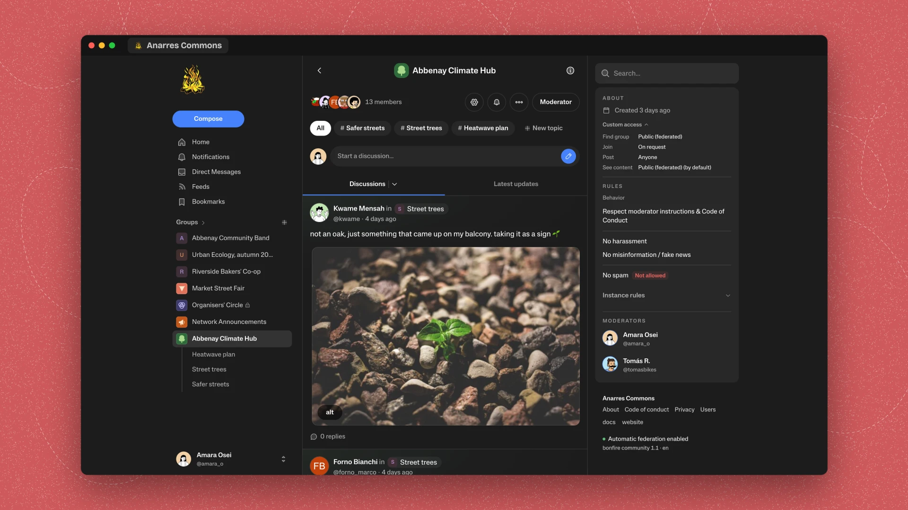
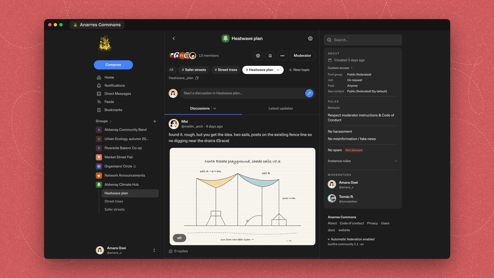
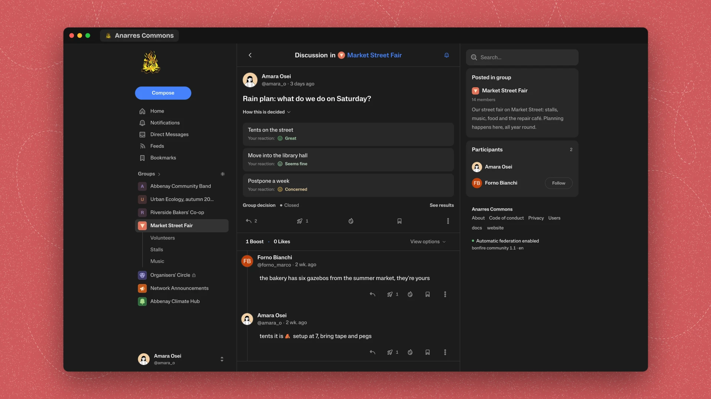
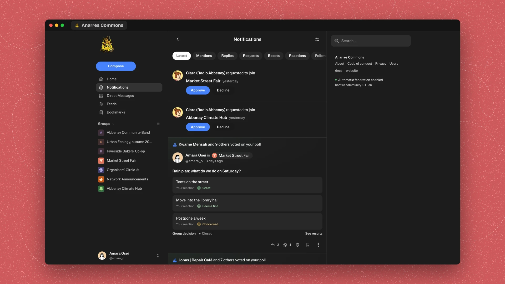

In 1895, H. G. Wells [sent a time traveller](https://www.gutenberg.org/ebooks/35) to the year 802,701, where he found childlike, carefree people living in apparent paradise, fed and clothed without ever working or thinking for it, never suspecting that people underground were toiling to provide for them, let alone why.

Half a century later, George [Orwell](https://en.wikipedia.org/wiki/Nineteen_Eighty-Four) showed how authoritarians turn care into control: the omnipresent screen, always watching and shaping us.

In 1984, Apple launched the Macintosh with [an ad](https://www.youtube.com/watch?v=ErwS24cBZPc) that borrowed Orwell's imagery, hurling a hammer through the giant screen and setting the audience free. The ad sold liberation, but three years later Apple revealed its vision for the future: the [Knowledge Navigator](https://www.youtube.com/watch?v=umJsITGzXd0) shows a solitary professor in a spacious study, talking to a bow-tied autonomous agent on a tablet that manages his research, his calendar and his calls. Big Brother had been smashed, just to be replaced by a butler, the same screen behind a friendlier mask.

Nearly forty years on, that vision is being delivered almost shot for shot, in every chatbot, agent and AI assistant now offering to run our lives. The gadget arrived, but the life around it didn't: as one commenter under the video points out, today that professor would more likely be an untenured adjunct living in a van than a man with a study bigger than most living rooms.

Anthropologist Anna Tsing [describes](https://fojournal.org/interview/anna-tsing-noticing-is-my-way-of-opposing/) how certain things get coded as possible futures, and then we develop blinders, walking towards "a stereotyped dream future. And so, we stopped seeing." The personal assistant is one of those futures.

But as David Graeber [put it](https://davidgraeber.org/books/the-ultimate-hidden-truth-of-the-world/), "the ultimate hidden truth of the world is that it is something that we make, and could just as easily make differently". Silicon Valley's future, each of us alone with our personal assistant, is only one way to make the world. We'd rather help make what the Zapatistas [call](https://enlacezapatista.ezln.org.mx/1996/01/01/cuarta-declaracion-de-la-selva-lacandona/) "a world where many worlds fit", with the communities we care about.

The things that bring communities together are bigger than any one of us: dealing with the climate crisis, keeping a town informed, creating knowledge for everyone, helping someone through a bad year... And no digital butler can take them off our hands. It takes people who learn, rise up, organise, change their minds, regroup, get things done, celebrate, and keep showing up for each other. The things that matter most are the ones we can only do together.

The release out today is an invitation to start making other futures, together.

## What's new in Bonfire for Communities 1.1

This release is built around one idea: equipping groups to organise, from their first conversation to their toughest decision.

### Groups, reworked with their communities

A group is an online space with its own members, goals, rules and moderation team, whether it's for a project, a neighbourhood, a working group or a whole organisation. Since July's launch, we've reworked them with the communities using them. Deciding who takes part, and how, is what turns a group into a real community, so it's theirs to make.

Each group sets its own boundaries: who can find the group, who can read posts, who can join (anyone, people on its server, on request, or by invitation) and who can post (anyone, members, or only moderators). Presets make it quick to start: an open network anyone on the fediverse can join, a local community reserved for people on the same server, an announcement channel where only moderators post, or a private club whose discussions are for members only. See the new [guide to groups](https://docs.bonfirenetworks.org/groups.html) for more.

### Federated groups

Nobody should have to relocate just to join a conversation or participate in a community. Our [plan](https://bonfirenetworks.org/posts/bonfire-for-communities/#what's-next) was compatibility first: agree on a federation standard with other projects, then make groups federate.

But the communities using them told us they couldn't wait: people wanted to take part from wherever they already are, and alliances of organisations, each on their own server, including servers that federate only with each other in [archipelago mode](https://bonfirenetworks.org/posts/bonfire-social-1-0-5-archipelago/), needed groups that span all of them.

As Bert Stavenuiter of Ypsilon (one of the 12 mental health non-profits building the Mentaal.nl network) puts it: "Bonfire enables each of our organisations to run its own community, while connecting peers, families and care workers across all of them."

Public groups on one Bonfire server can now be found, joined and followed from other Bonfire servers and from fediverse apps like Mastodon, Lemmy or PieFed. Communities don't have to ask everyone to relocate to one place or one app to take part together.

Open networks and announcement channels federate today. Local communities and private clubs stay on their own server for now, while we work out how to ensure privacy across servers.

Compatibility still comes first. With no standard yet, we took the long way round: we studied how many existing apps federate today, and tried to make Bonfire's groups work with them, so that we adapt to them and they don't have to adapt to us. And we're bringing what we learned along the way back to the W3C task force, so the eventual standard fits how groups already work as much as possible.

### A room for every topic

Topics were improved to help groups give every project, question or team its own space, so conversations don't get lost in the noise and newcomers can jump straight into what interests them. Topics in a public group now federate too, so people on other servers can follow and join them.

### Deciding together

Polls come in three kinds: a quick poll for a fast read on a question, a group decision where people suggest options and then score each one, and a consensus check that shows where a group agrees and where it doesn't, with optional blocks for serious objections.

Each server, and each group, can also agree its own community rules, starting from a library of rule examples put together by researchers at Princeton.

### Notifications on your terms

You choose who can reach you, about what, and how: in the app, on your phone, or in an email digest that gathers what happened while you were away. Nothing here is designed to keep you scrolling: notifications are for people to reach each other.

### Your choice of app

Bonfire comes with a powerful web app that you can also install on your phone or computer as a Progressive Web App, no app store needed. But nobody should be forced to use Bonfire's interface to take part: a Mastodon-compatible API, now in beta, enables existing apps to connect to Bonfire, and a GraphQL API is open to anyone who wants to build their own app for their community.

The full list of changes is in the [changelog](https://docs.bonfirenetworks.org/changelog.html).

## Join the first groups

New to groups? Start with our [guide to groups](https://docs.bonfirenetworks.org/groups.html).

To get things started, we're opening a few groups of our own, each with a mission, and you can join them from your existing fediverse account:

* [Bonfire Networks](https://bonfire.cafe/group/Bonfire_Networks): general group to share news/discussions/questions about Bonfire
* [Bonfire for Communities](https://bonfire.cafe/pub/group/01M6H0P4N7NBMB6ZNYFCVG1EYZ): communities who are using and building it, deciding together where it goes next.
* [Bonfire for Open Science](https://bonfire.cafe/pub/group/01M6H0PS09YC5QXXV1844XJDPK): researchers sharing work and making knowledge in the open.
* [Bonfire for Mutual Aid](https://bonfire.cafe/pub/group/01M6H0QJK4V8MTR7MT4WBYYZ77): groups organising care, gifts and help in their neighbourhoods, co-designing tools and pushing the boundaries of mutual aid networks.
* [Bonfire for Publishers](https://bonfire.cafe/pub/group/01M6H0R24Q3JAN0DFHG8TBS6N4): publishers, newsrooms and independent magazines sharing how they turn readers into a community, from conversations around articles to reader groups of their own.

For what applies across all of them, the general [Bonfire Networks](https://bonfire.cafe/group/Bonfire_Networks) group has topics for different areas:

* [Testing & Feedback](https://bonfire.cafe/group/Bonfire_Networks/topic/Testing_Feedback): try new features and tell us what works and what breaks.
* [UX & Design](https://bonfire.cafe/group/Bonfire_Networks/topic/UX_Design): help shape how Bonfire looks and works.
* [Third party apps](https://bonfire.cafe/group/Bonfire_Networks/topic/Third_party_apps): connect your favourite app through the Mastodon API beta, and help us make it work well.
* [Federation & interop](https://bonfire.cafe/group/Bonfire_Networks/topic/Federation_interop): compare notes on federation, report what doesn't interoperate, and help shape the standards.
* [Tech support](https://bonfire.cafe/group/Bonfire_Networks/topic/Tech_support): ask, answer and support each other in building and deploying Bonfire.

And why not start your own! (see the [guide to running a group](https://docs.bonfirenetworks.org/group-moderation.html))

## This is just the beginning

As [we wrote in 2021](https://bonfirenetworks.org/posts/let-a-thousand-bonfires-bloom/), "Federation will be a mess. Yes, and it will be fun!" Plurality is messier than a monopoly. It's a price worth paying so that no single company controls the infrastructure our communities organise on, free to enshittify it or switch it off on a whim. What others call chaos is really diversity, and it's where our power, resilience, and beauty come from.

> "Choosing Bonfire wasn't just a technical decision, it was a fundamentally political one. We wanted a platform that couldn't be switched off by a foreign government or bought out by a billionaire. That's exactly what we got: Bonfire built not simply for us, but with us, and the result belongs to our readers as much as it does to us."
> — Magdalena Berger, [Jacobin DE](https://bonfirenetworks.org/case-studies/jacobin/)

Soon, each group will be able to define roles for its members and what each one can do: who can post, who can invite, who can see things flagged for moderation, who can act on them, and who can review moderators' decisions. A tenants' union can give its "delegates" exactly the mix of permissions they need, and a food co-op can do the same for its "shift coordinators". That's why our proposal to the W3C groups task force, [now included in the draft specification](https://swicg.github.io/groups/#group-permissions), doesn't define fixed roles like "admin" and "moderator". Each group states who can do what, so it can name its own roles and any app can still make sense of them. It reuses a mechanism [GoToSocial introduced](https://docs.gotosocial.org/en/latest/federation/interaction_controls/), which Mastodon and others use to determine [who can quote a post](https://fediverse.codeberg.page/fep/fep/044f/). Federating private groups, better cross-instance moderation and moving groups between servers are among the next things to work out.

Beyond the fediverse, we're talking with bridge builders like [Bridgy Fed](https://fed.brid.gy/) and [Kazarma](https://kazar.ma/) so groups can reach people on ATproto and Matrix too, and communities on networks like [Blacksky](https://blackskyweb.xyz/)'s [Acorn](https://acorn.blacksky.community/) can organise across networks without anyone having to move.

Thank you to everyone who chipped in towards the maintenance and groups goals in our crowdfunding, and to the communities whose co-design is carrying groups the rest of the way. If you build fediverse software, or care about groups working the same way across every app, please [join the W3C task force](https://github.com/swicg/groups/issues).

## Human After All

Daft Punk once [said](https://www.npr.org/2013/05/16/184499357/daft-punk-on-the-soul-that-a-musician-can-bring) that computers "could do the music instead of us", and that while "we couldn't have done our project, definitely, without technology", "we don't really feel that's where the fun is". Neither do we. Bonfire is software, of course, but communities decide what it's for, what it becomes and who it serves, and the work itself is something we share.

So bring your people. Whether you gather **to learn, to rise up, to organise or to celebrate**, start a group from the account you already have, or set up a Bonfire of your own, and make it yours.

**Get your community back:** [bonfirenetworks.org/start](https://bonfirenetworks.org/start)
